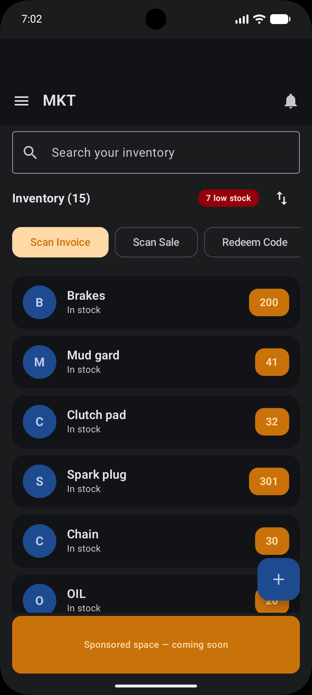
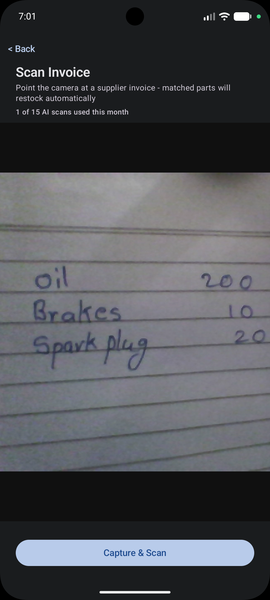
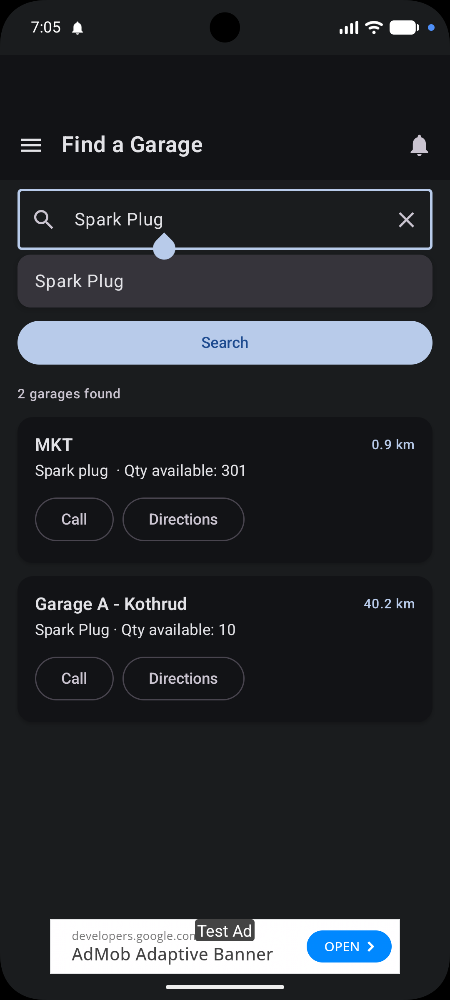
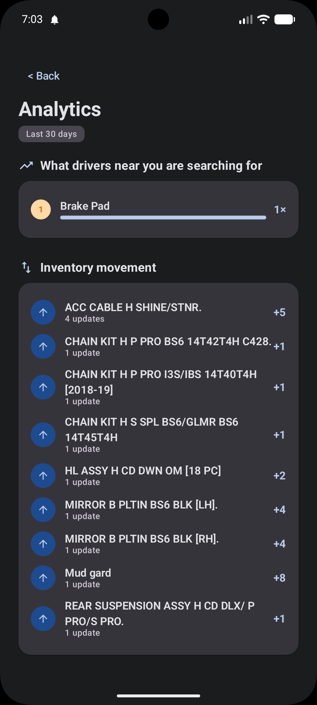
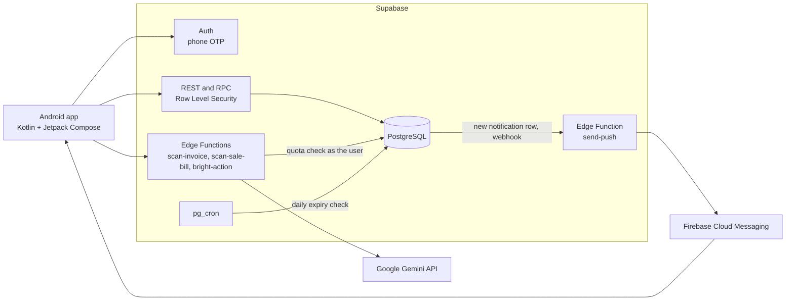

# GarageLink

[](https://github.com/Pruthviraj1705/garagelink/actions/workflows/android.yml)
[](https://github.com/Pruthviraj1705/garagelink/actions/workflows/database.yml)

A two-sided Android marketplace for spare-parts garages and the drivers who need parts, built with
**Kotlin, Jetpack Compose and Supabase**. Garage owners keep their stock up to date (including by
photographing supplier invoices and sale bills); drivers search for a part and see which nearby
garages have it in stock.

> Portfolio project. It is not published on Google Play, billing is simulated and SMS login uses
> Supabase test numbers. See [Known limitations](#known-limitations).

## What it does

**For garage owners**
- Inventory with search, sorting, low-stock alerts, per-part mute and a read-only offline mode
- **Scan a supplier invoice or a sale bill**: a photo is read by Google Gemini, items are matched to
  your stock with fuzzy matching, and you confirm before anything changes
- Analytics: what drivers nearby are searching for, and how your stock moved
- Push and in-app notifications (low stock, subscription expiring)
- AI business assistant that uses your low-stock items as context

**For drivers**
- Find a part: typo-tolerant search ranked by distance, with Call and Directions buttons
- Nearest garages and top garages, an AI vehicle assistant, offline emergency contacts

**For both**
- Phone-number login, light and dark theme, subscription plans with server-enforced limits,
  promo codes and a referral programme

## Screenshots

| Garage inventory | Invoice scan | Driver search | Analytics |
|---|---|---|---|
|  |  |  |  |

## How it works



The app never decides what a user may do; the backend does.

- **Identity comes from the token, not the request.** Every function that takes a user or garage id
  checks it against `auth.uid()` before doing anything.
- **Plan limits live in the database and the Edge Functions** (stock items, scans per month, AI
  messages and searches per day), so a modified app cannot bypass them.
- **Scanning**: the app sends the photo to an Edge Function, which verifies the user, checks and
  logs the quota, calls Gemini, and returns structured line items. The Gemini key never reaches the
  device.
- **Push**: inserting a row into `notifications` fires a database webhook to `send-push`, which looks
  up the user's device tokens and sends through FCM. The webhook is authenticated with a shared secret.

## Engineering highlights

- **Security review with a reproducible exploit.** Reviewing the live policies found that an owner
  or user could write their own `is_verified`, plan and subscription fields straight through the REST
  API. The fix is a guard trigger, proven by a test that fails without it. See
  [docs/security-audit.md](docs/security-audit.md).
- **Row Level Security on all 24 tables**, 28 policies, and 24 functions, all exported in
  [`supabase/sql/`](supabase/sql) and reproducible on an empty database.
- **Tests that run on every push**: 26 JVM unit tests (fuzzy matching and invoice parsing) and 23
  database security tests that build the schema on a throwaway PostgreSQL and attack it as a normal
  user.
- **Hardened Edge Functions**: the three user-facing functions verify the caller's JWT, validate and
  size-cap their input, and log provider errors instead of returning them; `send-push` authenticates
  with a shared secret.
- **Offline-tolerant**: cached inventory is shown read-only without a connection.

## Tech stack

| Layer | Technology |
|---|---|
| App | Kotlin, Jetpack Compose, Material 3, kotlinx.serialization |
| Backend | Supabase: PostgreSQL, Auth (phone OTP), PostgREST/RPC, Edge Functions (Deno/TypeScript), pg_cron |
| Search | PostgreSQL `pg_trgm` similarity; Levenshtein matching on the device for scanned items |
| AI | Google Gemini API (free tier) through its OpenAI-compatible endpoint |
| Push | Firebase Cloud Messaging (HTTP v1) |
| CI | GitHub Actions: Android build and unit tests; PostgreSQL schema and security tests |

## Repository layout

```
app/                     Android application (Kotlin, Compose)
supabase/
  sql/                   Schema, RLS policies, functions, triggers, indexes, security fixes
  functions/             Edge Functions: scan-invoice, scan-sale-bill, bright-action, send-push
  tests/                 Database security regression tests
docs/security-audit.md   Controls, findings and their status
.github/workflows/       CI
```

## Running it yourself

You need your own Supabase and Firebase projects; none of the secrets are in this repository.

1. **Database.** In the Supabase SQL Editor, run `supabase/sql/01_schema.sql` through
   `06_security_fixes.sql` in order. Seed your own subscription plans.
2. **Auth.** Enable the Phone provider and add test phone numbers.
3. **Edge Functions.** Deploy the four functions in `supabase/functions/`. Set the secrets
   `GEMINI_API_KEY` (free key from Google AI Studio), `FIREBASE_SERVICE_ACCOUNT` (service-account JSON)
   and `PUSH_WEBHOOK_SECRET` (any long random string). Deploy `send-push` with JWT verification off:
   it authenticates with the shared secret instead.
4. **Push webhook.** Create a Database Webhook on `INSERT` into `notifications` that calls
   `send-push` with the header `x-webhook-secret` set to the same value. Then schedule the daily
   expiry check as described in `supabase/sql/04_triggers.sql`.
5. **Firebase.** Create a project, register an Android app with package `com.pruthviraj.garagelink`,
   and save `google-services.json` in `app/` (it is git-ignored; `app/google-services.json.example`
   shows the shape).
6. **App config.** Put your project URL and anon key in
   `app/src/main/java/com/pruthviraj/garagelink/SupabaseConfig.kt`. The anon key is public by design;
   never put a `service_role` key in the app.
7. Open the project in Android Studio and run it.

## Testing

```bash
./gradlew testDebugUnitTest        # 26 JVM unit tests
bash supabase/tests/run_tests.sh   # 23 database security tests (needs local PostgreSQL 16)
```

## Known limitations

- **Billing is simulated.** The purchase functions grant a plan without verifying a payment. A real
  launch needs server-side payment verification (for example a gateway webhook).
- Login uses Supabase **test phone numbers**; production SMS would need a registered provider.
- Ads use Google's **test ad unit IDs**, and the app is not on Google Play.
- A scan is counted against the monthly quota before the AI provider is called, so a failed scan
  still uses one unit.
- The fallback invoice parser (used only when the AI returns no structured rows) has two known weak
  spots: single-digit quantities in a separate column are ignored, and any line containing "date",
  "tax", "total" or "gst" is treated as noise, even inside a part name.
- Discovery endpoints (nearby garages, part search) are callable without logging in; this is
  deliberate for a marketplace and is listed in the audit as an accepted risk.
- Supabase free projects pause after a week of inactivity.

## How this was built

Built with AI coding assistants (Claude and Gemini). I made the product and architecture decisions,
and tested, reviewed and hardened the output, including finding and fixing the issues documented in
the security audit.

## License

[MIT](LICENSE) © 2026 [Pruthviraj Vitthal Jagtap](https://github.com/Pruthviraj1705)
